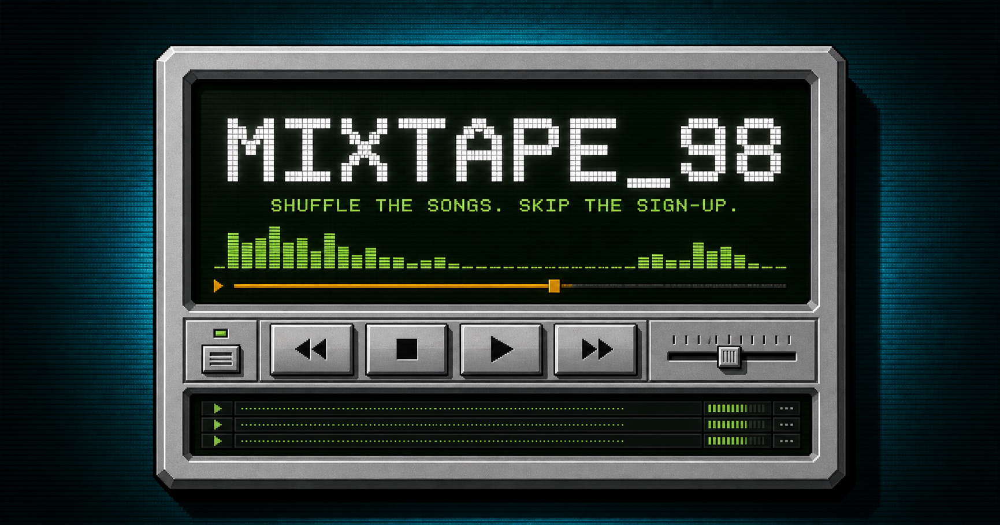

# MIXTAPE_98

A retro browser player for shareable Suno songs. Paste 1–50 Suno short, song, or embed links; shuffle them; and share the mix as one URL—without requiring a MIXTAPE_98 account.



[Try the live site](https://mixtape-98.promptguyera.chatgpt.site/)

## Features

- Accepts Public and Link Only `suno.com/s/...`, `/song/...`, and `/embed/...` links, including copied Markdown, tracking parameters, and trailing slashes
- Resolves short links, removes duplicates, and lists any rejected links for correction
- Shows song titles, creator names, artwork, and model labels when Suno supplies them
- Loads song details progressively, with a Refresh song action for newly generated or temporarily unavailable tracks
- Shuffle queue and visited-track Back, with artwork-driven ambient visuals
- Suno's in-page embed for protected media; native playback when Suno supplies a supported public audio URL
- Compact share links preserve the selected starting song and shuffle preference; older MIXTAPE_98 links still work
- Best-effort browser-local restore and a manual copy fallback if clipboard access is blocked

## Playback modes and new models

The player does not gate songs by model version. A new model label is displayed only when Suno returns it in song metadata; a title containing “V6” is not treated as proof of model version.

| Available media | Playback controls | Next track |
| --- | --- | --- |
| Suno embed / protected media | Press Play **inside the Suno window**. The outer SUNO PLAY button focuses that window; it cannot remotely control a cross-origin player. | Next and Back on MIXTAPE_98 navigate the queue manually. |
| Supported public audio URL | Outer Play/Pause, seek, volume, and Restart work directly. | Automatic advance when a song ends; Next and Back also work. |

Current Suno responses can return protected media even for older songs. MIXTAPE_98 does not decode protected files, guess alternate media URLs, or bypass access controls. Embedded playback stays on this page, but its availability and controls belong to Suno. The application cannot observe embedded playback completion, so it cannot reliably auto-advance or claim those songs were heard; session history records songs visited.

**Verification, September 9, 2026:** anonymous embedded playback was exercised with a v5.5 song, and metadata with existing v4.5 and v5.5 songs. A synthetic v6 metadata fixture verifies that no hard-coded version gate exists. No authentic public V6-generated sample was available for live verification, so exact V6 compatibility remains unverified. This release is compatibility preparation, not a claim of certified V6 support.

## Run locally

Requires Node.js 22.13 or newer.

```bash
git clone https://github.com/ObDixilis/mixtape-98.git
cd mixtape-98
npm ci
npm run dev
```

Quality checks:

```bash
npm run lint
npx tsc --noEmit --incremental false
npm test
```

Production build:

```bash
npm run build
npm run start
```

## How it works

The browser validates and canonicalizes song links. Server routes resolve short-link redirects with bounded requests and request metadata from a fixed Suno endpoint. Metadata requests publish results incrementally and are cancelled when a mix is replaced. The metadata route limits response size, times out slow upstream requests, and never follows upstream redirects.

Version 2 share payloads contain song IDs, mix title, and shuffle preference in `?mix=`; `?track=` selects the initial song. They are Base64URL-encoded, not encrypted, and are not stored in a MIXTAPE_98 database. Version 1 full-URL payloads remain readable. No individual playlist is bundled as the project's default content.

The 13 automated tests cover HTML rendering and metadata, link normalization, legacy and compact sharing, selected-song persistence in URLs, rapid-navigation playback intent, future-model metadata fixtures, protected-media fallback, Link Only caching, and upstream failure handling. They do not replace live provider/browser checks.

## Privacy

A share URL contains the mix title and complete song list. Anyone who receives that URL can read and reshare those details, including Link Only songs, so share only what you intend recipients to access. The most recent mix is stored in the listener's browser when storage is available. Suno receives requests for metadata, images, and embedded playback; MIXTAPE_98 cannot control Suno's own cookies or logging. Link Only metadata responses are marked private and no-store. No Suno API key or project-specific environment variable is required.

## Limits and service dependency

MIXTAPE_98 accepts individual shareable song links, not playlist URLs. It does not download, archive, or rehost songs. Its metadata lookup uses an undocumented Suno endpoint, and its native media host allowlist and Suno embed are controlled by Suno; any of these may change without notice. Removed, hidden, restricted, or unfinished songs may be unavailable. Browser policies may require a user gesture to start audio. Share links can be long because the full mix travels in the URL.

To contribute, open an issue or pull request in [the public repository](https://github.com/ObDixilis/mixtape-98). Include reproduction steps, browser/version, expected and actual behavior, and a shareable test song when useful. Do not include account tokens, private song links, or copyrighted media uploads. Run the quality checks above before submitting changes.

MIXTAPE_98 is an independent project and is not affiliated with or endorsed by Suno. Song audio, artwork, names, and trademarks belong to their respective owners. Use the project and shared music in accordance with applicable rights and service terms.

## License

The project code is available under the [MIT License](LICENSE). The license does not cover third-party songs, audio, artwork, names, or trademarks.
